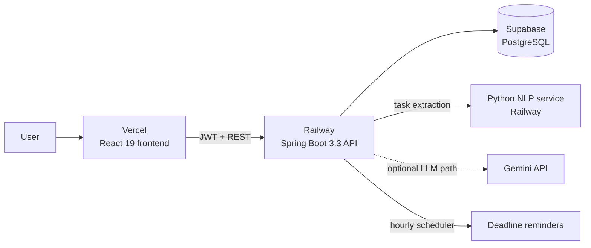
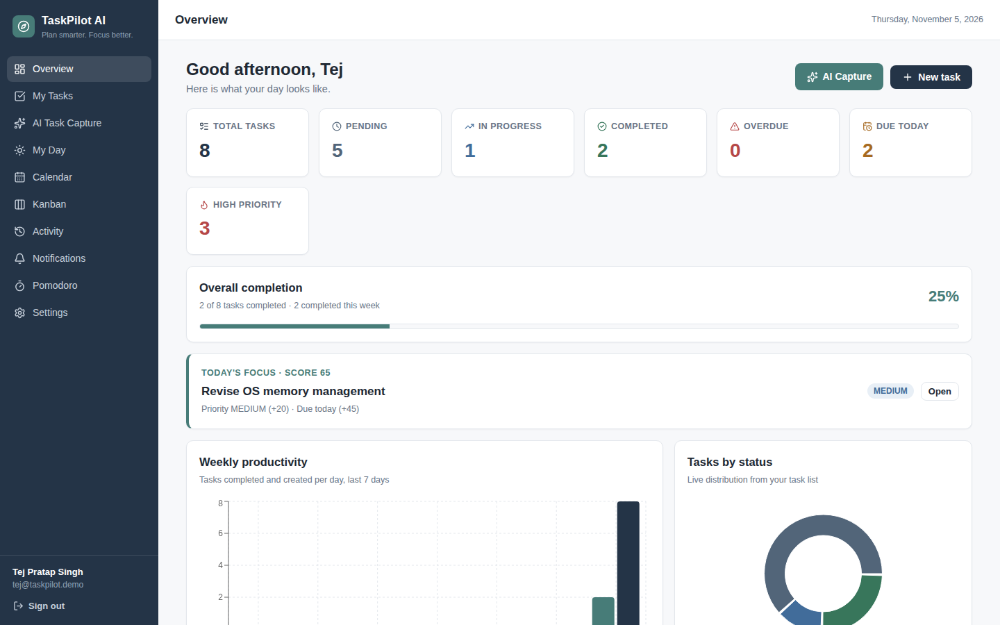
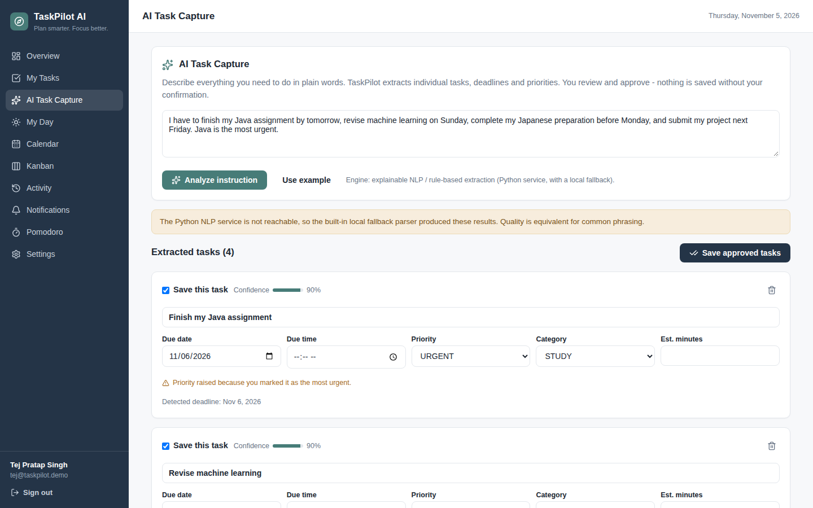
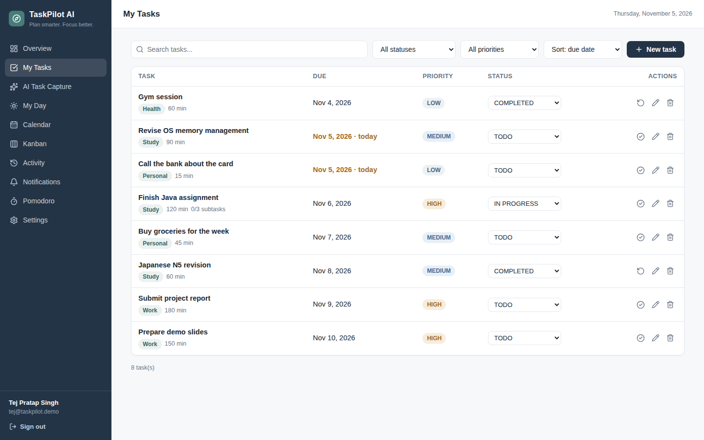
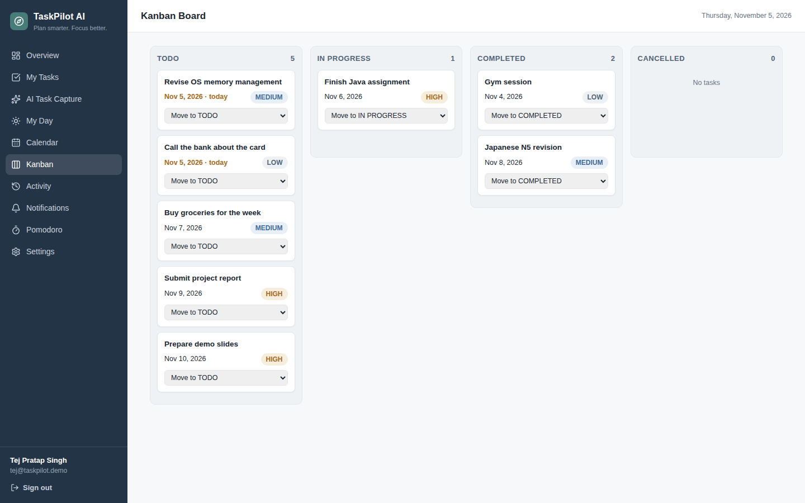
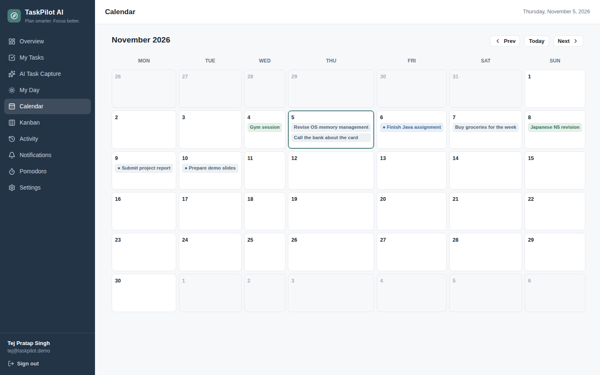

<h1 align="center">TaskPilot AI — Intelligent Personal Task Assistant</h1>

<p align="center"><strong>Plan smarter. Focus better. Get things done.</strong></p>

<p align="center">
  <a href="https://taskpilot-ai-gules.vercel.app"></a>
  
  
  
  
  
</p>

TaskPilot AI is a working task-management SaaS product that converts natural-language
instructions into structured tasks. You type a sentence; the system extracts individual
tasks, deadlines, priorities and categories; you review and approve; only approved
tasks are saved.

> Hackathon Problem Statement No. 41 — AI Personal Task Assistant

**Try it in 10 seconds:** open the [live app](https://taskpilot-ai-gules.vercel.app), create a
free account, and type *"Finish my Java assignment by tomorrow, revise machine learning on
Sunday, and submit my project next Friday. Java is the most urgent."* into AI Capture.

## What makes this different

Most student task apps are a pretty UI over fake data. This one is a deployed product:

- **Real accounts, real database** — BCrypt-hashed passwords, JWT sessions, PostgreSQL in
  production. Register on your phone, sign in on your laptop, your tasks are there.
- **AI suggests, you approve** — extraction never saves anything by itself. Every task is
  reviewed first, and every priority carries its *reason* ("Priority raised because you
  marked it as the most urgent").
- **Reminders that fire on their own** — an hourly scheduler generates overdue / due-today /
  due-tomorrow notifications from real task data, even if you never open the app.
- **Security tested like production** — login rate-limiting (429 after 5 failures), a strict
  CORS allowlist, password rules, and per-account data isolation *proven* with a two-account
  test: account B sees zero of account A's tasks.
- **Insights from real data** — weekly completion trends, per-category breakdown and streaks,
  computed from your actual task history. No placeholder numbers anywhere.
- **It broke in production — and got fixed properly.** End-to-end testing caught the task list
  failing on PostgreSQL (`lower(bytea)`: a null JPQL parameter binding as bytea). Root-caused
  and fixed with an explicit cast (commit `6373d20`), then re-verified live. That story is in
  [DEMO.md](DEMO.md).

## Live Demo

[](https://github.com/Tejpratap-069/TaskPilot-AI/actions/workflows/ci.yml)

- **Live app:** https://taskpilot-ai-gules.vercel.app — register an account and use the full product in the browser.
- **Backend API:** https://taskpilot-ai-production-7a32feca.up.railway.app — API docs (Swagger UI): https://taskpilot-ai-production-7a32feca.up.railway.app/swagger-ui.html
- **Deployment:** frontend on Vercel, Spring Boot backend on Railway, database on Supabase (PostgreSQL). Production runs on PostgreSQL through the env-configurable JDBC driver; local development uses MySQL 8 (see setup below).



## Verified in production

Every row below was executed against the live deployment on 2026-11-18 — not unit tests,
not localhost:

| Check | Result |
|---|---|
| Register a new account | 201 — persisted in PostgreSQL |
| Login with correct password | 200 + JWT issued |
| Login with wrong password | 401 — generic message, no account-existence leak |
| API call with no token | 401 "Authentication required" |
| Second account's task list | 0 tasks — per-account isolation holds |
| AI extraction of the demo sentence | 3 tasks, correct dates, URGENT flagged with its reason |
| Scheduled reminder | Created with zero user interaction (unread count 0 → 1 after scheduler run) |
| Brute-force probe | 5 failed logins → 401, 6th attempt → 429 |
| CORS probe from a random origin | 403 — only the app's own origins are allowlisted |
| Weak password registration | 400 — "at least one letter and one digit" enforced |
| Insights endpoint | Real weekly completions, category counts and streak returned |
| Task list on PostgreSQL | Was broken (`lower(bytea)`), fixed in `6373d20`, re-verified 200 |

## Screenshots

**Dashboard** — live stats, overall completion, Today's Focus and weekly productivity



**AI Task Capture** — type one instruction; TaskPilot extracts individual tasks with deadlines, priorities and categories for your review. Nothing is saved until you approve it.



**My Tasks** — search, filter and sort everything, with subtask progress on each card



**Kanban Board** — tasks grouped by status, moved with one click



**Calendar** — every deadline on a monthly view



## Architecture

| Layer | Technology | Role |
|---|---|---|
| Frontend | React + Vite, React Router, Recharts, Lucide | Premium SaaS UI (landing, auth, dashboard, AI capture, tasks, My Day, calendar, Kanban, activity, notifications, Pomodoro, settings) |
| Primary backend | **Java 21 + Spring Boot 3.3** (Spring Web, Spring Data JPA/Hibernate, Spring Security, JWT, BCrypt, Bean Validation, Springdoc OpenAPI) | ALL application data, auth, business logic, dashboard analytics |
| Database | **MySQL 8 / PostgreSQL** (JPA/Hibernate, JDBC driver chosen by env config) | users, tasks, categories, subtasks, task_history, notifications, user_preferences |
| NLP service | Python 3 (standard library only, zero dependencies) | Supporting service ONLY: natural-language extraction + explainable prioritization |

Java Spring Boot is the primary backend and the only component that talks to the database.
Python is never in the data path: if the Python service is down, the Java backend
falls back to a built-in parser implementing the same rules, so task capture keeps working.

The NLP engine is **rule-based NLP** (text segmentation, date parsing, keyword
classification, priority scoring). It is deliberately labelled as such — it is not a
trained machine-learning model, and it needs no paid API key.

## Deploying to the internet

See **DEPLOY.md** — the included `Dockerfile` builds the whole product (site + API + accounts) as one service for Railway/Render with a MySQL or PostgreSQL database, giving one public link that works on any device. This is exactly how the Live Demo above is deployed (Railway + Supabase PostgreSQL).

## Project structure

```
TaskPilot-AI/
  backend/       Spring Boot application (pom.xml, src/main/java/com/taskpilot/...)
                 - src/main/resources/db/schema.sql  (reference MySQL DDL)
  backend-ai/    nlp_service.py  (Python NLP service, port 8000)
  frontend/      React + Vite application (port 5173)
```

## Prerequisites

- JDK 21 and Maven 3.9+
- MySQL 8 running locally
- Node.js 18+ and npm
- Python 3.10+

## 1. MySQL setup

```sql
CREATE DATABASE taskpilot;
CREATE USER 'taskpilot'@'localhost' IDENTIFIED BY 'taskpilot';
GRANT ALL PRIVILEGES ON taskpilot.* TO 'taskpilot'@'localhost';
FLUSH PRIVILEGES;
```

Tables are created automatically by Hibernate on first run
(`spring.jpa.hibernate.ddl-auto=update`). A reference DDL is provided at
`backend/src/main/resources/db/schema.sql` if you prefer manual provisioning.

Database credentials are NOT hardcoded — they come from environment variables
(defaults below are for local development only):

| Variable | Default |
|---|---|
| `DB_URL` | `jdbc:mysql://localhost:3306/taskpilot?createDatabaseIfNotExist=true&useSSL=false&serverTimezone=UTC&allowPublicKeyRetrieval=true` |
| `DB_USERNAME` | `taskpilot` |
| `DB_PASSWORD` | `taskpilot` |
| `JWT_SECRET` | dev placeholder — **set your own in production** |
| `AI_SERVICE_URL` | `http://localhost:8000` |
| `SERVER_PORT` | `8080` |

## 2. Run the Python NLP service

```bash
cd backend-ai
python nlp_service.py            # listens on http://localhost:8000
# health check:  curl http://localhost:8000/health
```

No `pip install` is needed — it uses only the Python standard library.

## 3. Run the Java backend

```bash
cd backend
mvn spring-boot:run              # API on http://localhost:8080
# Swagger UI: http://localhost:8080/swagger-ui.html
```

### Optional demo account

For the live demo, set environment variables before starting the backend and a
demo account (with a few seed tasks) is created automatically. Nothing is
hardcoded; without these variables no demo account exists.

```bash
# Windows PowerShell example
$env:DEMO_USER_EMAIL="demo@taskpilot.ai"
$env:DEMO_USER_PASSWORD="demo1234"
mvn spring-boot:run
```

## 4. Run the frontend

```bash
cd frontend
npm install
npm run dev                      # http://localhost:5173
```

The frontend reads the API base URL from `frontend/.env`
(`VITE_API_BASE_URL=http://localhost:8080/api`).

## Demo workflow (evaluation script)

1. Open http://localhost:5173 → landing page → **Get started** → register, or sign in with the demo account.
2. Open **AI Task Capture** and paste:
   *"I have to finish my Java assignment by tomorrow, revise machine learning on Sunday, complete my Japanese preparation before Monday, and submit my project next Friday. Java is the most urgent."*
3. Click **Analyze instruction** → 4 extracted tasks appear with deadlines, priorities, categories and confidence. The Java task is URGENT because of the final sentence.
4. Edit a deadline or priority in the preview, untick one task, then **Save approved tasks**.
5. Open **My Tasks** → the approved tasks are there, persisted in MySQL.
6. Change a task's status (TODO → IN_PROGRESS → COMPLETED) from the list, the board, or My Day.
7. Return to **Overview** → totals, overdue, due-today, weekly chart and completion rate have updated from real data.
8. Open **Activity** → creation, status and priority changes are in the timeline.
9. Restart the backend and sign in again → all data survives (MySQL persistence).

## Key API endpoints

```
POST /api/auth/register        POST /api/auth/login         GET /api/auth/me
POST /api/ai/parse-tasks       POST /api/ai/prioritize
POST /api/tasks                GET  /api/tasks              GET /api/tasks/{id}
PUT  /api/tasks/{id}           PATCH /api/tasks/{id}/status PATCH /api/tasks/{id}/priority
DELETE /api/tasks/{id}         GET  /api/tasks/{id}/history
POST /api/tasks/{id}/subtasks  PATCH /api/tasks/{id}/subtasks/{subId}/toggle
GET  /api/dashboard/summary    GET  /api/dashboard/weekly   GET /api/dashboard/upcoming
GET  /api/dashboard/focus      GET  /api/dashboard/breakdown
GET  /api/planner/today        GET  /api/planner/upcoming   GET  /api/activity
GET  /api/notifications        PATCH /api/notifications/{id}/read
GET  /api/preferences          PUT  /api/preferences
```

Security model: every endpoint except `/api/auth/**` and Swagger requires a JWT.
The current user is always derived from the token's security context — never from
request parameters — and every task query is scoped to that user (cross-user access
returns 404). Passwords are stored only as BCrypt hashes.

## Running without MySQL (smoke tests)

The default profile is MySQL. For a quick smoke test on a machine without MySQL,
a `dev` profile uses an in-memory H2 database in MySQL-compatibility mode:

```bash
mvn spring-boot:run -Dspring-boot.run.profiles=dev
```

Data in dev profile does not persist between runs. Use the default MySQL profile
for the real demonstration.

## Tests

```bash
cd backend
mvn test
```

Test coverage: registration/login/invalid-login, unauthorized access (401),
task CRUD, status completion/reopening, ownership isolation, dashboard statistics
computed from real rows (including overdue calculation), task history recording,
and the AI parse endpoint through the local fallback parser (Python service
intentionally unreachable in the test profile). The NLP extraction rules are
additionally covered by unit tests for the Java fallback parser (multiple-task
extraction, weekday/month dates, the "most urgent" comparative boost, and
missing-date warnings).

## Design

The UI follows a restrained professional SaaS design system (Linear/Notion-inspired,
not copied): navy `#243447`, blue-gray `#526579`, teal accent `#477C78`, off-white
`#F7F8FA` background, white cards with thin `#E3E7EC` borders, Inter typography,
slim dark sidebar + white topbar. No gradients, glow or glassmorphism.
